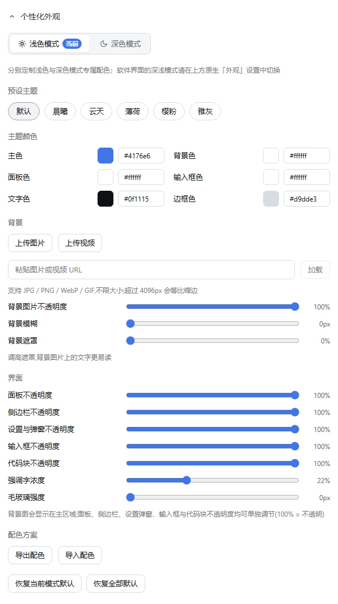
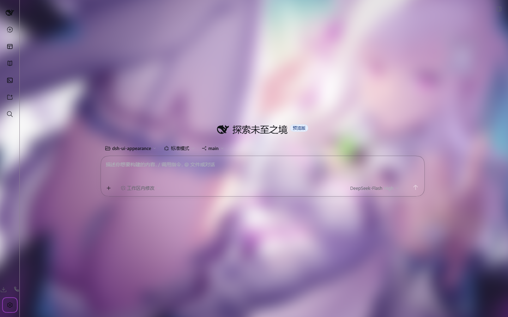
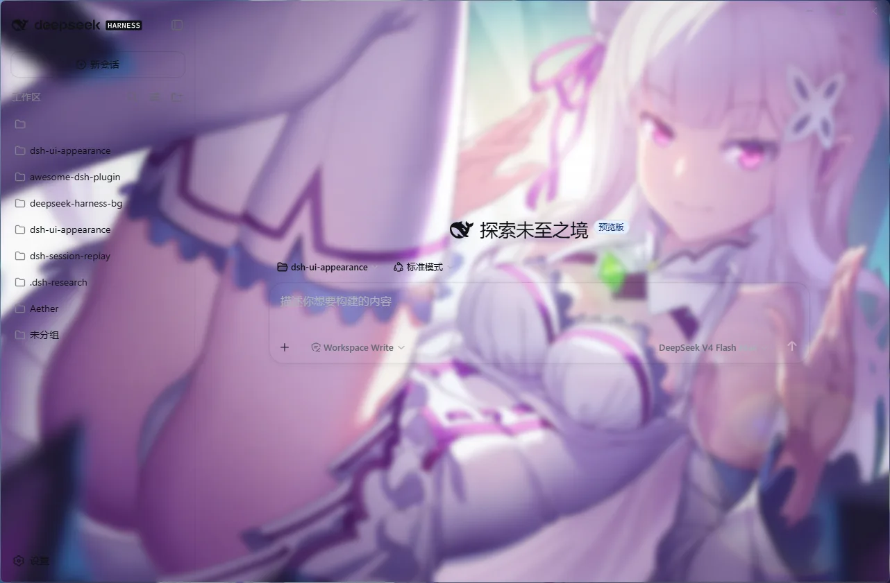
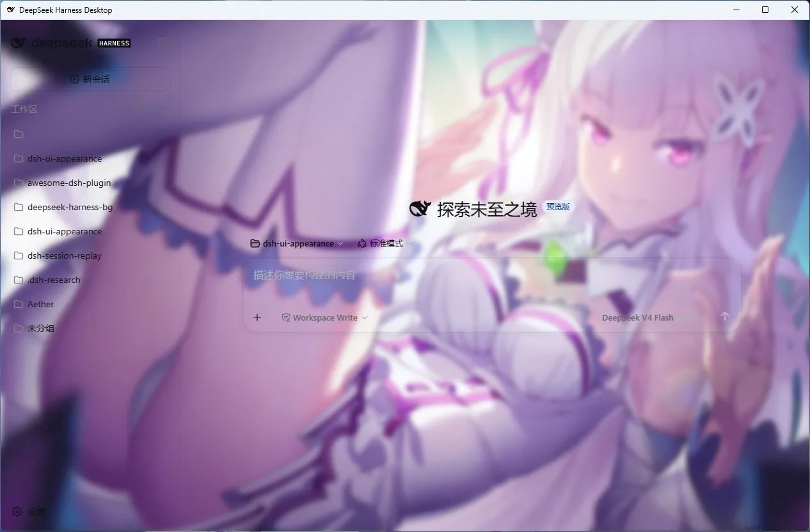
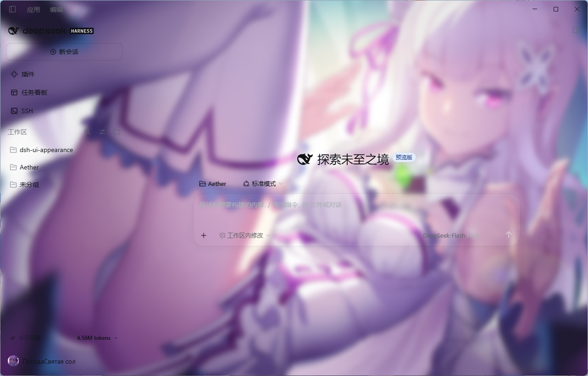

# dsh-ui-appearance

[中文](README.md) · English

The first appearance customization plugin in the DeepSeek Harness ecosystem supporting deep multi-dimensional UI parameter tuning — far beyond fixed presets, featuring fine-grained panel/input/code opacity controls, frosted glass, wallpaper/video backgrounds, and smart palette derivation; works on both WebUI and DSH Desktop.

[](https://awesome-dsh-plugin.com/p/TQSY114514/dsh-ui-appearance/)
[](https://www.npmjs.com/package/dsh-ui-appearance)
[](https://www.npmjs.com/package/dsh-ui-appearance)
[](https://github.com/TQSY114514/dsh-ui-appearance/actions/workflows/build.yml)
[](https://github.com/TQSY114514/dsh-ui-appearance/releases)
[](./LICENSE)

> Zero core-code changes: everything goes through the official plugin mechanism (`ctx.theme.overrideTokens()` theme extension point and the `settings.general.item` slot). Uninstalling restores the stock UI completely.

## Screenshots

| Settings panel | Wallpaper + glassmorphism |
|---|---|
|  |  |

It also works out of the box on **[DSH Desktop](https://github.com/anywhere-labs/deepseek-harness-desktop)**, the desktop client — real screenshots:

| Advanced mode (native desktop layout & materials) | Compatible mode (stock upstream Web client) |
|---|---|
|  |  |

Latest official Desktop screenshot (community shots kept above):

| Official Desktop (new advanced mode) |
|---|
|  |

> The wallpaper in the screenshots is © MadYY ([source](docs/wallpaper-madYY.png)), shown for demonstration only — users upload their own images.

## Features

**Independent Dual-Mode Appearance** — Segmented tabs for "Light Mode" and "Dark Mode" at the top of the settings panel to configure 6 color roles and distinct presets independently. Dynamically adapts to host theme changes and the system `prefers-color-scheme`. Integrates a WCAG 2.1 auto-contrast algorithm (`a11yLabelStep`) to guarantee secondary text $\ge 7:1$ and tertiary text $\ge 4.5:1$, completely eliminating washed-out text on light mode and invisible icons on dark mode.

**Theme Colors** — 6 core color roles: accent, background, panel, input, text, border. Each role features a native color picker and precise HEX input; text selection, keyboard focus rings, the top-left "harness" logo, and message bubbles seamlessly adapt to the accent color.

**Wallpaper & Video Backgrounds (Up to 200MB)** — Upload or drag in images (JPG / PNG / WebP / GIF), or **paste a URL to load in one click** (auto-routed by extension; works with CORS-friendly hosts). Stored directly as IndexedDB Blobs (zero heap memory duplication, free from localStorage quota; images over 4096px are proportionally downscaled, GIF animations preserved). Brightness is sampled on upload to auto-derive an harmonious accent palette. Supports hardware-accelerated **dynamic video backgrounds** (MP4 / WebM, muted loop playback, up to 200MB).

**Glassmorphism & Multi-Dimensional Independent Translucency** — **Main panels, sidebar, settings & modals, composer input, and code blocks** each have independent 0%–100% continuous opacity sliders (keeping the settings dialog crisp and readable even when main chat surfaces are 100% transparent). **Frosted glass blur (`glassBlur`) is fully decoupled from background blur (`backgroundBlur`)**: background blur applies exclusively to the wallpaper/video canvas, while frosted glass targets UI surfaces (sidebar, composer input, `/` slash command menu, message bubbles, code blocks, settings/modals, and modal backdrop masks). Inline code chips preserve a low-alpha accent tint with a dedicated "emphasis tint" slider; neutral interactive controls and buttons bake alpha synchronously on hover, preventing sudden opaque snapping (`hover snapped opaque`).

**Three-Layer Background Architecture** — An innovative 3-layer rendering system: canvas base layer (custom solid background color) + media layer (wallpaper/video with independent blur and opacity) + anti-glare scrim layer (adaptive veil protecting text readability). Lowering media opacity blends smoothly into your custom background color without white flash.

**Dedicated Dual-Mode Presets** — 5 curated light presets (Dawn, Sky, Mint, Sakura, Clay) + 6 classic dark presets (Default, Midnight, Ocean, Forest, Rose, Monochrome); apply with one click and fine-tune freely.

**Scheme Sharing** — Export your palette as JSON directly to the clipboard; paste to import. Share and discover community schemes in GitHub Discussions!

Every change applies live — no refresh, no save button.

## Installation

### Option 1: npm one-liner (recommended)

```sh
dsh plugin --profile <name> add dsh-ui-appearance
```

### Option 2: one-command script (Windows, no npm account and no git needed)

```powershell
powershell -ExecutionPolicy Bypass -Command "Invoke-WebRequest 'https://raw.githubusercontent.com/TQSY114514/dsh-ui-appearance/main/install.ps1' -OutFile install.ps1; .\install.ps1"
```

The script pulls the pre-built package straight from the npm registry (the published tarball ships the built `lib/`), links it into the profile's own `node_modules` and registers it in that profile's `package.json` (a `dependencies` entry plus `dsh.profile.bundles`, matching what `dsh plugin add` produces) — idempotent, safe to re-run. Optional parameters:

```powershell
.\install.ps1 -Version '0.1.7'      # pin a version (default: latest release)
.\install.ps1 -DshHome 'D:\.dsh'    # custom DSH home (default %DSH_HOME% or %USERPROFILE%\.dsh)
.\install.ps1 -ProfileName 'web'    # target profile (default web; must be initialized)
```

### Option 3: from source (verified end to end)

```sh
git clone https://github.com/TQSY114514/dsh-ui-appearance.git
dsh plugin --profile <name> add file:<path-to-clone>
```

Uninstall: `dsh plugin --profile <name> remove dsh-ui-appearance` (for the script install, delete the junction under the profile's `node_modules` plus the `dependencies`/`bundles` entries it added to the profile's `package.json`).

**Updating**: after a new release, simply re-run `add` or the install script to upgrade to the latest version.

> **DSH Desktop users**: Desktop keeps its own profiles, independent from the WebUI. All three methods above work — just install into the profile Desktop actually activates (named `desktop` by default; inside the built-in Desktop terminal, a plain `dsh plugin` already targets the active profile).

> Both installation paths (npm registry and `file:` source install) are verified end to end: the host half has zero `@deepseek-ai` runtime dependencies, and both the browser and the Host load correctly. After cloning, `pnpm install` builds automatically; after code changes, re-run `pnpm install && pnpm prepare` and restart `dsh web`.
> Release history: [CHANGELOG.md](CHANGELOG.md).

## Usage

1. Open the WebUI, go to Settings → General in the sidebar.
2. Below the Appearance row, find "个性化外观" (Personalized appearance) and expand it.
3. Pick a preset for a quick skin, fine-tune the 6 color roles with pickers or HEX input, upload or drag in a wallpaper/video, and drag the ambience and interface sliders.
4. Done. Everything applies live — no refresh, no save.

Settings panel at a glance:

| Section | Controls |
|---|---|
| Mode & Presets | Independent Light Mode (Default / Dawn / Sky / Mint / Sakura / Clay) and Dark Mode (Default / Midnight / Ocean / Forest / Rose / Monochrome) presets; free to keep tuning after applying |
| Theme colors | 6 roles × (picker + HEX): accent (with auto bubble-text contrast toggle), background (with auto global-text contrast toggle), panel, input, text, border |
| Background | Image upload/replace/remove, video upload/remove, **load from URL (image/video)**, image opacity, background blur, scrim |
| Interface | Panel opacity, sidebar opacity, settings & modal opacity, input opacity, code-block opacity, emphasis tint, glass blur |
| Color scheme | Export palette, import palette (JSON text) |

## Persistence & reset

- Settings live in browser localStorage (key `dsh-ui-appearance.settings`); they survive refresh and restart and sync across tabs.
- Removing the plugin from the profile restores the stock UI: disposal reclaims every overridden token, stylesheet and background layer.
- Note: settings follow the browser — switching browsers or clearing site data loses them; wallpapers are stored at original quality in IndexedDB (localStorage only carries the record key), free from the localStorage quota, and persistent storage is requested from the browser to lower eviction risk.

## How it works

| Capability | Mechanism |
|---|---|
| **Colors & Contrast** | `ctx.theme.overrideTokens()` overrides `--dsw-alias-*` semantic tokens with dual-mode independence. Built-in WCAG 2.1 dynamic contrast algorithm (`a11yLabelStep`) ensures secondary text $\ge 7:1$ and tertiary text $\ge 4.5:1$, completely eliminating washed-out text on light mode and invisible icons on dark mode |
| **Three-Layer Background** | Three decoupled layers (base canvas + media layer + anti-glare scrim), pushed to `position: fixed; z-index: -1`. When wallpaper/video is active, the official host base (`--dsw-alias-bg-base`) is **punched to transparent**, leaving `#root` free of `position`/`z-index` to eliminate stacking context traps and keep dialogs always on top |
| **Component-Level Glass & Anti-Bleed** | Background blur uses a canvas `filter: blur` with `inset: -48px` extension to eliminate translucent vignetting at screen edges; frosted glass (`glassBlur`) is decoupled into component-level `backdrop-filter`, using `::before` pseudo-element isolation on the sidebar (`[class*="_sidebarCol"]::before`) and composer card (`[data-composer-card]::before`) so Windows desktop `position: fixed` titlebar buttons are never trapped and the `/` slash command overlay is never clipped by a CSS Backdrop Root |
| **Hover Feedback Closure** | Neutral control and button hover tokens (`--dsw-alias-interactive-bg-hover` and `-solid`) bake opacity synchronously under translucent mode, fine-tuning lightness (10%~15%) while strictly revealing background to prevent sudden opaque snapping (`hover snapped opaque`) |
| **Native Video Streaming** | Hardware-accelerated Chromium native streaming with muted loop playback. Videos are stored directly as IndexedDB Blobs (up to 200MB) without Base64 encoding and with zero extra heap duplication |
| **Persistence & Garbage Collection** | Settings saved in browser `localStorage` (key `dsh-ui-appearance.settings`) with instantaneous cross-tab sync; media stored in `IndexedDB`. Replacing media or resetting to stock immediately performs Blob garbage collection (`deleteImage` / `deleteVideo`) to prevent orphaned files |

## Compatibility & limitations

- **Works Across Platforms**: Full support for WebUI and [DSH Desktop](https://github.com/anywhere-labs/deepseek-harness-desktop) (both advanced and compatible modes); includes an automated punch-through patch for Windows custom titlebar frames (`.BynINW_frame`, [#31](https://github.com/TQSY114514/dsh-ui-appearance/issues/31)).
- **Dual-Mode Independent Palettes**: Saves two independent sets of 6-color palettes and presets for Light and Dark modes, smoothly adapting to system and host color schemes.
- **Performance & Low-End Optimization**: Translucency is pre-baked as CSS `rgba()` with automatic transition freezing during active slider drags for 60fps responsiveness; low-end devices can set the "Glass Blur" and "Background Blur" sliders to 0 for instant rendering.
- **Large Media Support**: Original images are stored losslessly in IndexedDB (auto-scaled proportionally above 4096px as WebP, GIF animations preserved within bounds); video ceiling expanded to 200MB with drag-and-drop and URL loading.
- **Syntax Highlighting & Bubbles**: Code syntax highlighting (Shiki) follows independent syntax language rules; user message bubbles blend into the accent color while AI responses remain transparent.

## FAQ

- **Q: Customizer panel does not appear in DSH settings after installation or update?**
  - **Check Profile**: Verify the plugin is installed to the active profile (DSH Desktop defaults to `desktop`, WebUI defaults to `web`; run `dsh plugin list` to check).
  - **Build & Restart**: When installing from source, ensure `pnpm prepare` was run to compile `lib/` before restarting DSH services (e.g. `dsh web`).
  - **Clear Cache**: Hard-refresh via `Ctrl + F5` (`Cmd + Shift + R` on macOS) to purge old bundle caches.

- **Q: Why does the UI still show a solid background with no wallpaper/video visible?**
  - **Punch-through Occlusion**: The background layer sits at `z-index: -1`, revealing itself by setting `--dsw-alias-bg-base` to `transparent`. If an opaque **third-party skin** is active (e.g. themes hardcoding solid colors onto `body` or `#root`), the transparent punch-hole is blocked. Deactivate third-party opaque skins or reduce their opacity.
  - **Windows Desktop Custom Frame**: Upgrade to the latest plugin version; automated punch-through for Windows desktop titlebar frames is built-in ([#31](https://github.com/TQSY114514/dsh-ui-appearance/issues/31)).

- **Q: Why doesn't the "Glass Blur" slider show a frosted effect on the sidebar/input/settings panel? And how do I keep the settings dialog readable when the main chat is 100% transparent?**
  - **Pair with Translucency**: Frosted glass (`backdrop-filter`) requires a translucent surface to reveal the blurred backdrop behind it. If "Sidebar Opacity", "Input Opacity", or "Settings & Modal Opacity" is left at `100%` (fully solid), the opaque fill hides the blur; lower the corresponding opacity slider to `40%–80%` to let the frosted glass shine through.
  - **Independent Opacity Channels**: Main panels, sidebar, settings & modals, composer input, and code blocks each have their own opacity slider. You can set "Panel Opacity" to `0%` for an unobstructed wallpaper in the chat view while keeping "Settings & Modal Opacity" at `80%–95%` with "Glass Blur" enabled for crisp readability.

- **Q: Video background shows black screen or fails to play?**
  - **Codec Compatibility**: Chromium natively supports hardware decoding for **H.264 (MP4)** and **VP8 / VP9 (WebM)**. If the video uses unsupported codecs (such as HEVC / H.265, certain `.mov` containers, or specific audio tracks), decoding will fail. Please re-encode with tools like HandBrake or FFmpeg to standard H.264 MP4 before uploading.

- **Q: Pasting an image or video URL fails to load?**
  - **CORS & Hotlink Protection**: Due to browser security sandboxes, remote URLs must allow cross-origin requests (CORS headers) without strict hotlink protection. For restricted links, download the file locally and drag it in (stored directly in IndexedDB with zero network dependency).

- **Q: Does resetting settings or frequently changing videos bloat the disk?**
  - **Not at all**. The plugin implements strict lifecycle garbage collection: replacing media or clicking "Reset All" immediately triggers `deleteImage` and `deleteVideo` to purge old Blobs from IndexedDB, preventing orphan file buildup.

- **Q: Where are my appearance configurations saved? How to backup and sync across devices?**
  - Settings are saved in browser `localStorage`, while images and videos live in `IndexedDB`.
  - **Backup & Migrate**: Under the "Color Schemes" section in the panel, click "Export Scheme" to copy JSON. Paste and click "Import" on any other device or browser to restore instantly. Welcome to share your creative presets in GitHub Discussions!

- **Q: Does uninstalling the plugin leave stale styles or break the stock DSH UI?**
  - **Completely clean**. The plugin adheres strictly to the "Zero core modification, 100% reversible" manifesto. Executing `dsh plugin remove dsh-ui-appearance` unregisters all token overrides, removes `#dsw-appearance-bg` and dynamic stylesheets, and restores the stock UI with pixel-perfect fidelity.

## Package layout

```
src/
├── index.ts                  # Host half (empty apply, zero runtime deps)
├── invariant.ts              # Runtime invariant companion
├── appearance-settings.ts    # Settings types & defaults
└── client/
    ├── index.ts              # apply(): localStorage persistence, slot registration
    ├── applier.ts            # DOM applier (token overrides, 3-layer background, glass)
    ├── tokens.ts             # Color roles → token mapping, dual-mode presets, alpha baking
    ├── color.ts / image.ts   # Color utilities / image preparation (>4096px rescale, lossless)
    ├── blob-db.ts            # IndexedDB base (DB v2: image + video stores)
    ├── image-store.ts        # IndexedDB image storage (keyed reference & GC)
    ├── video-store.ts        # IndexedDB video storage (200MB cap & GC)
    ├── color-scheme.ts       # Scheme export/import (pure functions)
    ├── settings-store.ts     # Settings mirror store
    ├── locales.ts            # zh/en copy
    └── AppearanceCustomizerRow.tsx + .module.css   # Settings row UI
tests/                        # Tests (`pnpm test` runs standalone; @deepseek-ai runtime replaced by tests/stubs)
types/client.d.ts             # Hand-written client-half type declarations
cordis.patch.yml              # Bundle patch
tsdown.standalone.config.ts   # Self-contained build
vitest.config.ts              # Standalone test config (aliases to tests/stubs)
lib/                          # Build output
```

All `@deepseek-ai/*` dependencies are optional peers provided by the host at runtime; the only runtime dependency is `clsx`. **174 vitest tests green** (runnable standalone in this repo); CI build and artifact assertions green.

## License

MIT
